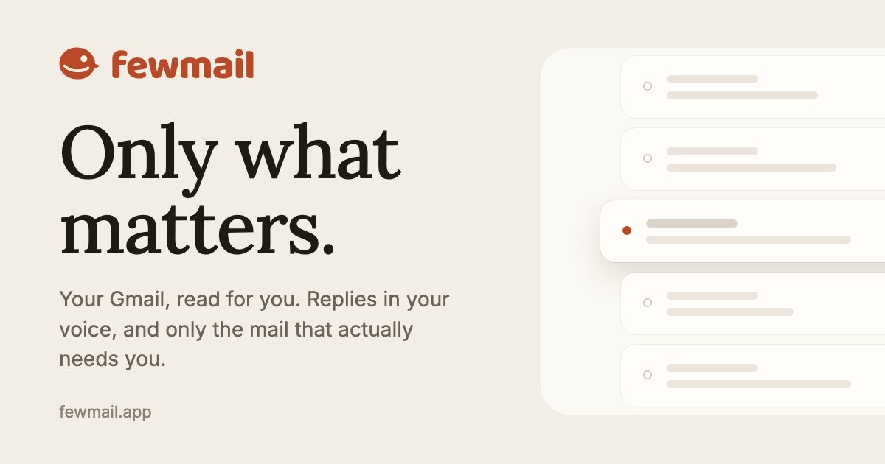

#  Fewmail

_The AI email agent for Gmail: it reads every email first and shows you only what needs you_

<a href="https://fewmail.app">
  
</a>



We built Fewmail because email clients only make you faster at reading every email. We wanted one that reads them for us.

It sorts what arrives, clears the noise, drafts replies in your voice and leaves you a few decisions. Nothing is sent or changed in Gmail without your yes.

## Get started

1. Open [fewmail.app](https://fewmail.app) or [download the desktop app](https://github.com/wannabespace/fewmail/releases/latest).
2. Sign in with Google.
3. Fewmail starts with the last three days of mail, so the first decisions are waiting right away.

## What's inside

- Home: what needs you today, with replies already drafted.
- Every email read and sorted, with a summary and an importance score.
- Drafts in your tone and in the sender's language. They wait for your approval.
- Rules in plain words. Only the rules you turn on act on their own.
- Newsletters in one summary, each sentence linked to its email.
- Spam and phishing warnings: changed bank details, lookalike domains, known scams.
- Calendar and people next to the inbox.
- MCP server. Claude, ChatGPT, Claude Code and Cursor can read your mail. Anything that sends or changes Gmail waits for your click in Fewmail.
- Telegram and WhatsApp bots for urgent mail and approvals on the go.

## Small things we care about

- Nothing changes in Gmail without your yes. Sending always asks.
- Subjects, bodies, summaries and drafts are encrypted in the database.
- Your mail never trains models.
- An email that tries to give the agent orders is flagged before the agent reads it.
- Sorting, rules and spam protection are free forever. The agent comes with a paid plan.
- Open source. You can read every line that touches your mail.

## Run it yourself

You need [pnpm](https://pnpm.io), [Bun](https://bun.sh), [Docker](https://docs.docker.com/get-docker/) (for Postgres) and a Google Cloud OAuth client with the Gmail API enabled.

```bash
cp .env.example .env   # Google OAuth and OpenRouter; the rest is optional
pnpm install
pnpm docker:start
pnpm db:migrate
pnpm dev
```

The app opens at https://app.local.fewmail.app and the API at https://api.local.fewmail.app. Tests: `pnpm test`.

Working on the code with an agent? Start at [AGENTS.md](AGENTS.md).

## Security

Found a vulnerability? Please report it privately, see [SECURITY.md](.github/SECURITY.md). How we prepare for Google's security assessment is in [CASA.md](CASA.md).

## Issues

We don't accept pull requests. But we read every issue.

Found a bug or something off by one pixel? [Open an issue](https://github.com/wannabespace/fewmail/issues).

## License

[AGPL-3.0](LICENSE)

<div align="center">
  <sub>Built with ❤️ by <a href="https://wannabespace.com">Wannabe Space</a></sub>
</div>
